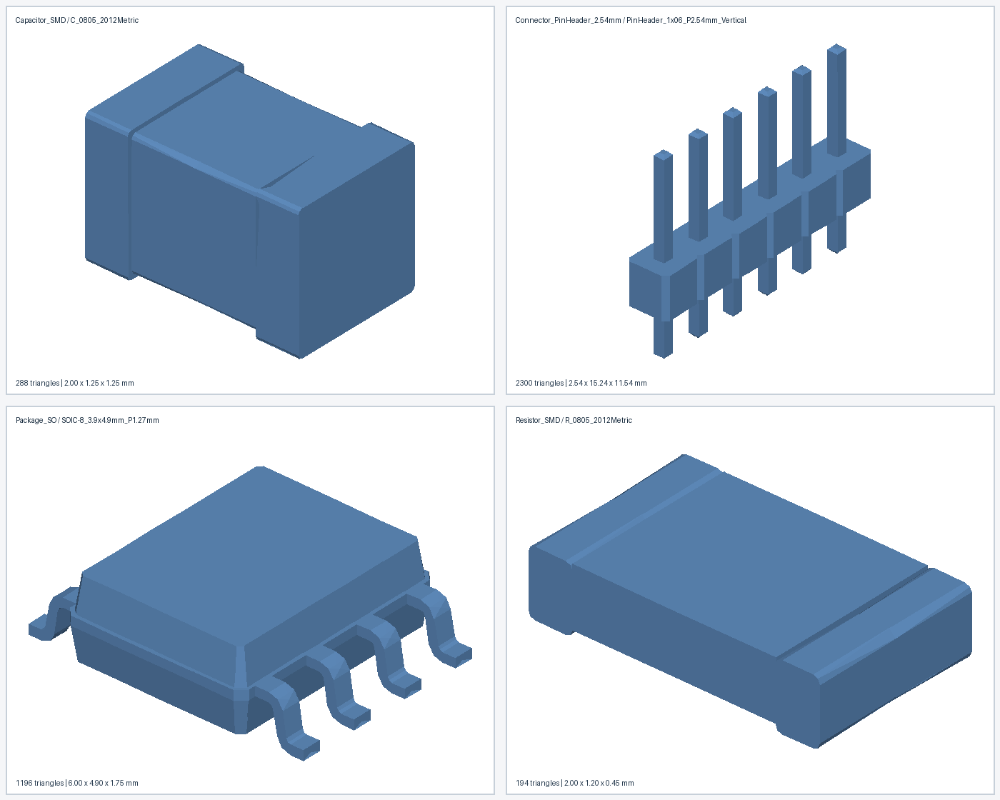

# Приёмка рабочего конвертера KiCad → FreePCB2

## Цель и критерий завершения

Обновлённое техническое задание требует автоматического переноса библиотечных
УГО, footprints и связанных 3D-моделей из KiCad в FreePCB2, пакетной обработки
с журналом ошибок, демонстрации на реальных библиотеках и проверки результата
в Схематоре и ПлатФорм. Отдельно требуется показать STEP → STL на примерах и
оценить полноту переноса. Требования успешно преобразовать **каждый** объект
официальных библиотек KiCad в ТЗ нет.

Для подтверждения «рабочего конвертера» нужны одновременно:

1. Воспроизводимая конвертация реальных исходных УГО и footprints с точными
   номерами выводов/площадок; неподдерживаемые объекты получают явный отказ.
2. Создание связанного компонента УГО → footprint → имеющийся STL, где номера
   совпадают; неполные модельные зависимости обозначены явно.
3. Пакетный запуск, отчёт ошибок, повторный запуск и проверка перенесённого
   комплекта.
4. Успешные native load/save, netlist, Gerber/drill и board 3D на контрольных
   примерах в FreePCB2 2.428 и Схематоре 1.429 с сохранёнными доказательствами.
5. Пробный STEP → STL и проверка геометрии полученных образцов.

Пункты 1–3 подтверждены автоматическими проверками для поддержанного профиля.
Пункт 5 выполнен на четырёх примерах ниже. Пункт 4 — [Windows-проверка](WINDOWS_HANDOFF.md),
её результат пока неизвестен. Найденные там дефекты необходимо исправить и
повторить затронутые сценарии до объявления конвертера прошедшим приёмку.

## Текущее покрытие и его границы

| Объект | Результат автоматического полного прогона |
|---|---:|
| Footprints | 14 109 FPL из 15 464; 1 355 явных отказов |
| УГО | 12 186 CDS из 21 806; 9 620 явных отказов |
| Связанные компоненты с точным сопоставлением номеров | 8 210 CDS/FPL; 94 540 пар вывод/площадка |
| Зависимости 3D-моделей в связанной партии | 6 993 полных; 1 217 частичных или отсутствующих |

Все успешные записи имеют отчёты о потерях. Отказы не считаются успешной
конвертацией. Эти числа измеряют **покрытие текущего профиля**, а не процент
готовности проекта или требование достичь 100%. Полные результаты: [footprints](FULL_LIBRARY.md),
[УГО](SYMBOL_BATCH.md), [связанные компоненты](MASS_COMPONENTS.md).

## STEP → STL: выполненная проба

Четыре исходных STEP скопированы из `step_files/` в отдельный каталог
`output/step-stl-demo/source/`. Скрипт `step_stl_conversion_checked.py`
с Gmsh **4.15.2** и настройками `--mesh-min 0.01 --mesh-max 0.5`
создал STL в `output/step-stl-demo/generated/`. Существующее хранилище
`stl_files/` не изменялось и 7 225 старых моделей не пересоздавались.

| Исходная модель | Треугольники | Габариты STEP, мм | Ошибка объёма STL к CAD |
|---|---:|---:|---:|
| `Capacitor_SMD/C_0805_2012Metric` | 288 | 2,00 × 1,25 × 1,25 | 0,053% |
| `Connector_PinHeader_2.54mm/PinHeader_1x06_P2.54mm_Vertical` | 2 300 | 2,54 × 15,24 × 11,54 | <0,001% |
| `Package_SO/SOIC-8_3.9x4.9mm_P1.27mm` | 1 196 | 6,00 × 4,90 × 1,75 | 0,068% |
| `Resistor_SMD/R_0805_2012Metric` | 194 | 2,00 × 1,20 × 0,45 | 0,286% |

Независимый `src.step_stl_audit` прочитал бинарные STL, получил CAD bounding
boxes/объёмы через Gmsh и проверил: **4/4 пробы**, максимальная ошибка
внешней координаты **0,00000017 мм**, 0 вырожденных треугольников,
0 открытых/неманифолдных/несогласованно ориентированных рёбер. Повторный запуск
в отдельный каталог дал те же SHA256 всех четырёх STL. Изображение
`output/step-stl-demo/preview.png` просмотрено: корпуса, шесть выводов разъёма
и восемь тонких выводов SOIC-8 различимы, явных пропаж на этих образцах нет.
Это проверка четырёх выбранных моделей; она не доказывает качество всех STL или
их физическое положение на плате.



Локальные материалы: `output/step-stl-demo/` содержит копии четырёх STEP,
новые STL, `audit.json`, два журнала конвертации и PNG для демонстрации.
Каталог не добавлен в Git из-за бинарных исходников/результатов; компактная
копия аудита с относительными путями и hashes сохранена в отслеживаемом
[`output/step-stl-demo.summary.json`](../output/step-stl-demo.summary.json).
Для повторения с подготовленными `step_files/` и Gmsh в Python-окружении:

```sh
python3 -m venv /tmp/ki-freepcb-gmsh
/tmp/ki-freepcb-gmsh/bin/python -m pip install gmsh==4.15.2
/tmp/ki-freepcb-gmsh/bin/python -B step_stl_conversion_checked.py \
  --input output/step-stl-demo/source \
  --output output/step-stl-demo/generated-new \
  --mesh-min 0.01 --mesh-max 0.5
/tmp/ki-freepcb-gmsh/bin/python -B -m src.step_stl_audit \
  output/step-stl-demo/source output/step-stl-demo/generated-new \
  output/step-stl-demo/audit-new.json --reference stl_files
```

Нужен отдельный **новый** выходной каталог, чтобы не заменять ранее полученные
STL. В новом клоне четыре указанных в таблице STEP сначала нужно скопировать
из `step_files/` в `output/step-stl-demo/source/` с сохранением `.3dshapes`
каталогов. Audit по умолчанию допускает 0,01 мм по bounding box и 1% по объёму;
численные допуски не заменяют визуальную проверку сложных деталей.

## Оставшийся шаг приёмки

Передать [Windows-комплект](WINDOWS_HANDOFF.md) и получить `results/run.json`,
native сохранения, netlist, Gerber/drill, screenshots и board SCAD. Протокол
содержит десять сценариев. Только после их фактического прохождения и
исправления обнаруженных отклонений можно назвать поддержанный профиль
проверенным в целевых программах. Полная поддержка всех библиотек KiCad —
отдельное расширение, не условие этой приёмки.
